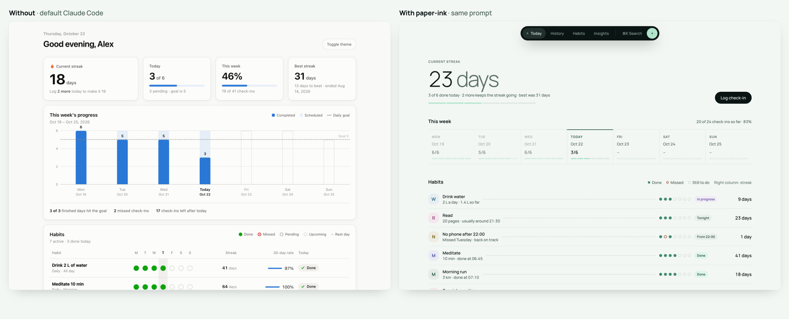
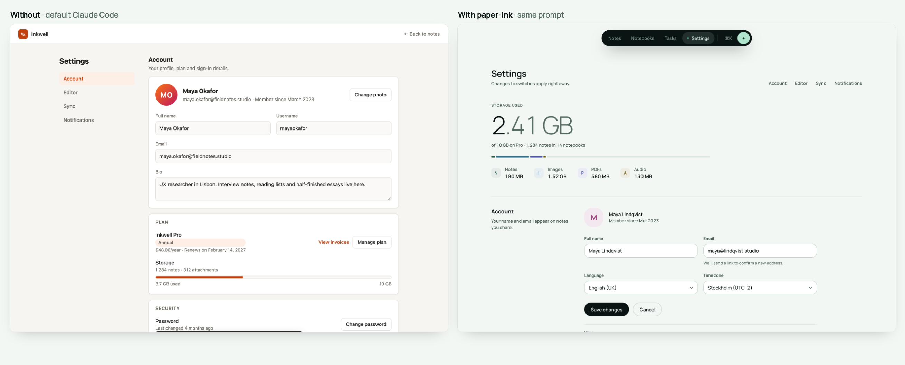
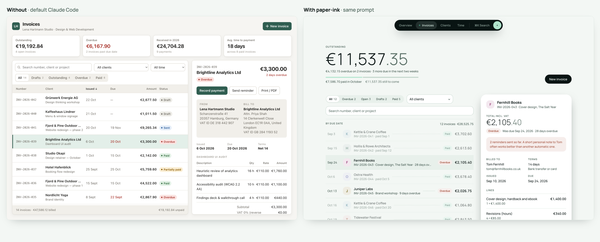
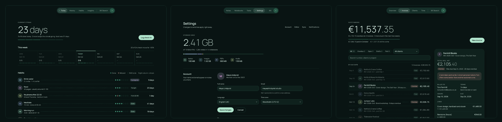

# paper-ink

**Calm, paper-like UI for your coding agent.**

paper-ink is a design skill for Claude Code and Codex. When your agent builds an app screen (a dashboard, a list, a form, a settings page) it uses one quiet design language instead of the usual stack of shadowed cards and blue buttons: mint-white paper, deep green ink, hairlines instead of boxes, one big number per screen.

It isn't made up for the README. It's the design system of [Subbrook](https://github.com/erenbekman/subbrook), a local-first subscription tracker, pulled out and made general so it fits any app.



## Same prompt, with and without

Each pair is one prompt, run in an empty folder with Claude Code. The left side is the default output. The right side is the same prompt plus *"Use the paper-ink skill."* Nothing was retouched by hand, apart from one date-formatting bug fixed in the invoices page.

**"Build a settings page for a note-taking app."**



**"Build an invoices list with filters and a detail panel."**



Every screen also has a dark theme ("Ink") that follows the system setting:



The finished screens are in [`skills/paper-ink/examples`](skills/paper-ink/examples). Open any `index.html` in a browser; there's no build step.

| Example | Prompt |
|---|---|
| [`habit-dashboard`](skills/paper-ink/examples/habit-dashboard) | Build a dashboard for a habit tracker. Show today's streak, this week's progress and a list of habits with their status. |
| [`settings`](skills/paper-ink/examples/settings) | Build a settings page for a note-taking app. Include account, editor preferences, sync and notifications sections. |
| [`invoices`](skills/paper-ink/examples/invoices) | Build an invoices screen for a small freelance business: a list of invoices with filters and a detail panel for the selected invoice. |

All three prompts also asked for a static page (`index.html` plus CSS, no build step) with realistic sample data.

## Install

**Claude Code plugin**

```
/plugin marketplace add erenbekman/paper-ink
/plugin install paper-ink@paper-ink
```

**skills CLI** (Claude Code, Codex and other agents)

```bash
npx skills add erenbekman/paper-ink
```

**By hand**

```bash
git clone https://github.com/erenbekman/paper-ink
```

Copy `skills/paper-ink` to `~/.claude/skills/paper-ink` for Claude Code, or to `~/.agents/skills/paper-ink` for Codex.

## Use

Ask for a screen the way you normally would. The skill loads by itself when the agent builds app UI, or you can name it:

> Build a billing page for my app. Use the paper-ink skill.

> Restyle the dashboard in `src/pages` with paper-ink.

It works with plain HTML, Vue, React, Svelte and Tailwind (v3 preset and v4 theme). It's for app screens, not landing pages, posters or slides.

## The five rules

1. **Paper, not panels.** Content sits straight on the page, rows split by 1px lines. Cards are only for things that float, three per screen at most.
2. **One hero number.** Each screen opens with one large, light number. Everything else is smaller and quieter.
3. **Ink acts, mint confirms.** One filled button per screen. Mint only ever means "done".
4. **Time runs left to right.** Dated things sit on a line or in a date-ordered list, with the past faded.
5. **Colour carries meaning only.** Category colours on tiles and charts; two state colours, always with words. No gradients.

## What's inside

```
skills/paper-ink/
├── SKILL.md             rules, tokens, components and a check list for the agent
├── tokens.css           colours, spacing, radii, shadows; light and dark
├── paper-ink.css        base styles and component classes
├── tailwind.css         Tailwind v4 theme
├── tailwind.preset.js   Tailwind v3 preset
├── references/          principles, components, layout, voice, what not to do
└── examples/            the three screens above
```

The agent reads `SKILL.md` first and opens the reference files only when it needs them, so the skill costs little context.

## Credits

- Palette: [Color Hunt 091413 · 285A48 · 408A71 · B0E4CC](https://colorhunt.co/palette/091413285a48408a71b0e4cc)
- Typeface: [Manrope](https://fonts.google.com/specimen/Manrope) by Mikhail Sharanda (SIL Open Font License)
- Design language: [Subbrook](https://github.com/erenbekman/subbrook)

## License

MIT
